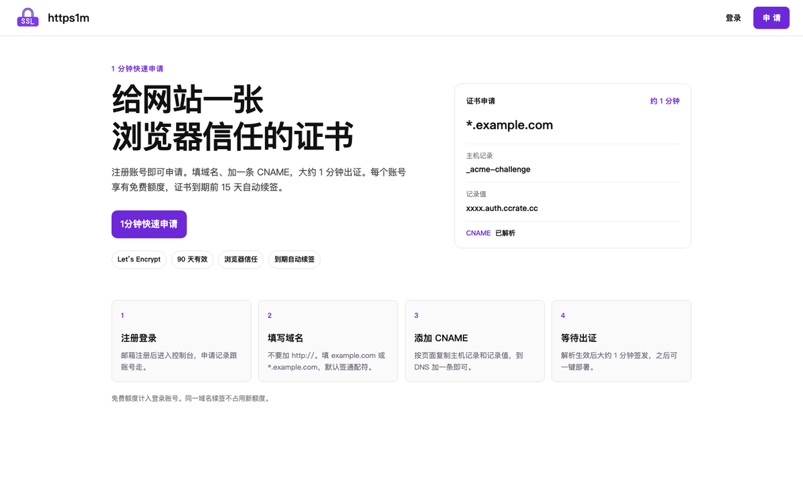
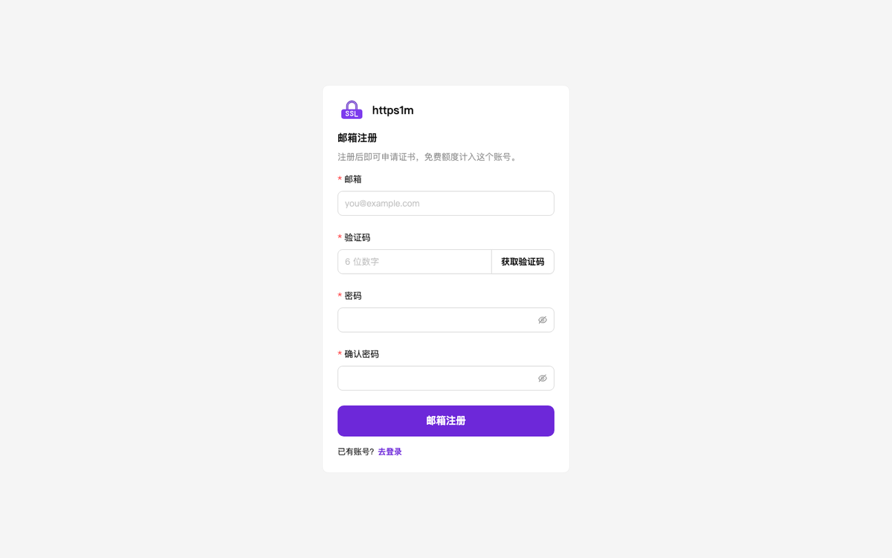
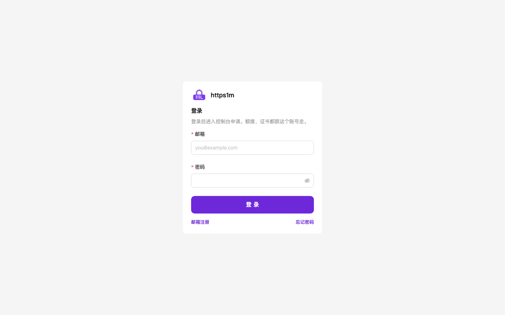
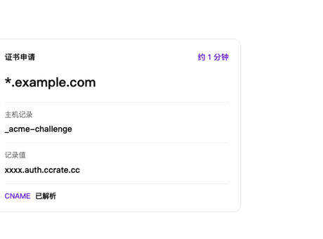

# https1m

免费 SSL 证书 · Let’s Encrypt · HTTPS · TLS · ACME · 通配符证书 · 1 分钟签发

`ssl` `https` `tls` `letsencrypt` `acme` `ssl-certificate` `wildcard-ssl` `free-ssl` `https-certificate` `nginx` `apache` `caddy` `baota`

**打开网站试用：[https://ssl.ccrate.cc](https://ssl.ccrate.cc)**

浏览器信任的 SSL / HTTPS 证书，Let’s Encrypt 签发，90 天有效，到期自动续签。适合网站、API、宝塔、Nginx、Apache、Caddy。

  

## 流程

注册 → 填写域名 → 加一条 CNAME → 约 1 分钟出证 → 下载，或按页面部署到服务器

### 1. 注册登录

打开 [https://ssl.ccrate.cc](https://ssl.ccrate.cc)，用邮箱注册并登录。申请记录跟这个账号走。

  
  

### 2. 申请证书

进入控制台，点 **免费申请**。域名不要加 `http://`。

- 填 `example.com` 或 `*.example.com`
- 默认按通配符签发（wildcard SSL），根域和一级子域名都能用

### 3. 添加 CNAME

页面会给出主机记录和记录值，到域名 DNS 加 **一条 CNAME** 做 ACME 验证。

  

Cloudflare 不要开小云朵（代理）。这条记录只需配一次，续签也靠它，加好后不要删。

### 4. 等待出证

解析生效后大约 1 分钟。页面变成「已签发」后，可以下载证书。

同一域名续签不占用新额度。

### 5. 部署到服务器（可选）

登录后打开 **自动部署**，按页面复制命令，在服务器用 root 执行。看到「全部完成」即可。

之后这台机器会出现在 **主机管理**。新签发或即将到期的证书，会自动写到这台机器。

## 关键词

免费SSL、SSL证书、HTTPS证书、Let’s Encrypt、ACME、通配符证书、wildcard、TLS、宝塔SSL、Nginx SSL、Apache SSL、Caddy HTTPS、域名证书、自动续签
